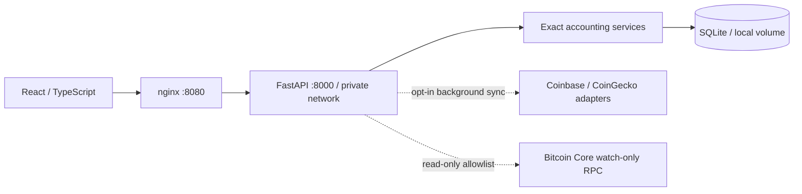

# Architecture and accounting decisions

Appalachian Bitcoin is a single-owner, local-first application. The browser talks to FastAPI through the same-origin nginx proxy. SQLite is the system of record. No external account or service is required. Public Coinbase/CoinGecko prices are opt-in; Bitcoin Core is optional.

## Money and denominations

- `BITCOIN` is the internal currency code for native base units. A bitcoin wallet stores whole signed integers. `BTC` only means 100,000,000 base units at compatibility or report boundaries.
- USD stores integer cents. The initial release supports only USD and native bitcoin as original currencies. Adding other currencies requires currency-specific precision and FX providers.
- Rates and asset quantities are decimal strings, avoiding SQLite's floating-point NUMERIC coercion. Python `Decimal` performs conversions, with 60-digit local precision for multiplication/division. Rounding is half-even.
- The reversible storage range is −(2^63−1) through +(2^63−1). Individual postings and account balances are checked. Excluding −2^63 guarantees that every posting can be negated in a reversal.
- All monetary API values are strings; IDs and nonfinancial counters are numbers. Display formatting never casts money to JavaScript `Number`. Charts alone use approximate number coordinates; accompanying financial tables retain exact values.
- Equivalent values round to a whole bitcoin, eight BTC decimals, or two USD decimals. Totals sum these independently rounded line/account values, so totals reconcile with displayed components.

## Journal design

Asset-account debits are positive. Liability balances are credits internally (negative), displayed as positive debt owed. Income posts a debit to the receiving account and a credit to an internal income account. Expense does the reverse against an expense account. Transfers debit the recipient and credit the sender. A loan-principal payment is a transfer to the liability account; interest is a separate expense.

Journal creation is one database transaction. Each entry starts as a draft, receives at least two postings, and is sealed as posted. Python validates per-currency balance. SQLite triggers independently reject unbalanced sealing, mutation or deletion of sealed entries, and all posting updates/deletions. Account currency and role are fixed. Audit events and exchange-rate rows are append-only.

Cross-currency transfers require both actual amounts. Two clearing postings balance each currency independently. They do not manufacture an exchange rate and do not enter income or expense reports. This is a multi-currency personal ledger, not a tax-lot or realized-gain engine. Fees must be recorded separately.

Opening balances, manual adjustments, and asset appreciation/depreciation offset equity. They are excluded from operating cash flow and category budgets. Assets link one-to-one to financial accounts and therefore are not counted twice in net worth. Quantities are exact metadata; manual valuations are total account values, not unit prices.

Edits append a reversal of the original entry and a replacement. Deletions append only a reversal. The effective date is the original date, so corrected historical reports restate the prior period. Creation timestamps and audit records show when the correction was made. This is not a closed-period statutory accounting system.

Valuations are append-only in strictly increasing date order. Once a dated valuation exists, ordinary entries and reversals at or before that valuation are refused for that account. This prevents a backdated posting from invalidating a later absolute valuation. Use a current adjustment when reconciling previously valued records.

## Valuation semantics

1. Recorded bitcoin holdings include only monetary accounts (`bitcoin_wallet`, `checking`, `savings`, `cash`) whose original currency is BITCOIN and that are not linked to an `Asset`. USD monetary accounts are dollar cash/deposits. Brokerage, property, vehicles, other assets, and all manually valued asset links are asset valuations regardless of their denomination. Liabilities are always debt. A bitcoin-denominated property is not a bitcoin holding.
2. Fiat transaction purchasing power uses an immutable snapshot for the exact transaction date. Missing data yields `null`/Unavailable. Recording a later price does not rewrite earlier entries; explicitly edit/save to create a corrected entry with the new snapshot.
3. Today's account values use the latest stored quote on or before today. Its source, effective date and stale status are exposed. There is no automatic external refresh or undisclosed fallback.
4. Historical net worth uses balances as of the report date and an exact-date quote. Monthly points use month end; the current month uses today. Missing historical prices create gaps.

For zero balances, a rate is unnecessary. Any nonzero missing conversion makes the dependent total unavailable rather than understating it. The BIP-177 naming convention follows the [BIP-177 draft specification](https://github.com/bitcoin/bips/blob/master/bip-0177.mediawiki); it is an explicit application convention, not a claim that the proposal has been universally adopted.

## Two reporting currencies

New users default to USD; explicit saved preferences are preserved. The API keeps its original BITCOIN default for existing consumers, while the UI always sends its selected reporting unit. Native balances are independent of that selection. `/api/reports` returns `ownership`, `native_flows`, source-currency-filtered `flows`, and `performance`, alongside exact monthly history. Up to 120 monthly observations are supported. Histories describe recorded entries, not financial activity predating the ledger.

The overview uses `native_other_assets` and `native_liabilities` to total recorded balances separately by currency. Neither depends on an exchange rate. No combined net worth is displayed in the UI; the API retains its valuation fields for compatibility. The reporting toggle affects expense and account-history conversions only. Account performance starts at the first displayed monthly observation and ends at the last. Net additions include signed non-valuation postings (opening entries, adjustments, transfers, income, and expenses) after the first observation through the last. Reversed entries and their reversals are excluded together. Every contribution uses its immutable rate snapshot. Value change is ending value minus starting value minus net additions; it includes valuation, exchange-rate, and line-rounding effects. Any required missing rate makes the dependent figure unavailable. No investment-return percentage or tax gain is inferred.

`Budget.amount_minor` is exact USD cents or whole bitcoin, with `currency` and `scope`. Uniqueness is month/category/currency. `native` scope consumes expenses only in that original currency and needs no conversion. `all` scope explicitly converts all category spending at transaction snapshots. The currency-budget migration preserves every prior bitcoin budget as `BITCOIN` / `all`, unchanged in amount and behavior. Direct API inputs retain the USD / native default for compatibility. The simplified budget editor explicitly saves USD / all plans. The legacy API `bitcoin` input remains supported for combined bitcoin plans; it cannot be mixed with the new amount/currency/scope fields.

The UI uses `/api/budget-overview` for one card per category: an existing USD allowance plus posted category expenses expressed in USD and bitcoin using their immutable snapshots. All category expenses count in this view. Income, transfers, opening balances, and valuations do not. No spending means zero bitcoin spent, irrespective of the allowance. A missing snapshot makes the dependent spending total unavailable. Older bitcoin allowances are never converted to invented dollar plans. The original `/api/budgets` view retains historical currency/scope semantics; reading the new view does not mutate any plan. Saving through the simplified editor explicitly uses a USD plan for all category expenses.

Visible native bitcoin amounts use the `₿` prefix without a repeated unit suffix. Dollar amounts use `$`; legacy BTC keeps the explicit `BTC` suffix and eight decimal places. Accessible labels still identify native bitcoin. Exact decimal-string formatting is unchanged.

CSV exports label theoretical equivalents explicitly and include actual destination amount/currency separately. Converting a valuation never posts bitcoin; only an actual journal entry changes holdings. The browser formats exact strings and uses floating point solely for chart coordinates and progress geometry. Chart tooltips use the exact API decimal strings.

## Persistence and concurrency

SQLAlchemy models cover Users, Sessions, LoginAttempts, Accounts, Categories, JournalEntries, Postings, ExchangeRates, Assets, AssetPrices, Budgets, WalletConnections, ImportJobs and AuditEvents. Alembic includes a frozen initial schema and separate database-guard and currency-budget migrations. Foreign keys are enabled on every SQLAlchemy connection.

Run exactly one Uvicorn worker. A process-wide writer lock serializes authenticated request sessions, mutation, export and restore. This trades throughput for predictable local SQLite behavior and safe backups. Multi-owner isolation, multiple workers, background ingest, large-ledger query optimization and pagination are future work. Never run two backend instances on the same database.

## Authentication and privacy

One local owner is created through the first-run screen. Argon2id hashes passwords. Random session tokens are stored only as SHA-256 hashes; HttpOnly, SameSite=Strict cookies expire after 12 hours. Each mutation requires a session-bound CSRF header. Origin and Host allowlists protect same-origin use and reduce DNS-rebinding risk. Login attempts are persisted and limited to ten per 15 minutes per connection IP. Password changes and restore revoke sessions. The reverse proxy makes clients share its IP, so the login limit is intentionally installation-wide in Compose.

No tracking scripts, analytics, cloud identities, telemetry exporters, remote fonts, or external imagery are included. FastAPI's transitive OpenTelemetry API library has no configured provider/exporter. SQLite itself is not encrypted at rest; protect the host and its volume using OS permissions and disk encryption. Backups are encrypted, separately from the live database.

Secrets remain in a protected environment/configuration. Bitcoin Core RPC credentials never go to the frontend or ledger database. The adapter allows only `getblockchaininfo`, `getwalletinfo`, `getbalances`, and `listtransactions`. It rejects wallets with private keys enabled. No spend/sign/key-export code exists.

## Backup integrity

Export uses SQLite's backup API for a consistent snapshot. Session and login-attempt rows are removed from the snapshot. A random 16-byte salt feeds scrypt (N=32768, r=8, p=1); AES-256-GCM uses a random 12-byte nonce and authenticated version header. The encrypted payload includes the complete database and its Alembic revision.

Restore authenticates before parsing, then checks database integrity, exact schema/trigger compatibility, foreign keys, one-owner cardinality, posted status, balanced postings per currency and valid exchange rates. Only a validated candidate is copied through SQLite's transactional backup API. All sessions are cleared. Restores require the same schema version. The in-app backup limit is 32 MB; see the filesystem procedure for larger ledgers.

## Integrations and current limits

Current quotes live in `price_quotes`, separately from append-only daily references in `exchange_rates`. Coinbase uses completed UTC daily closes; optional CoinGecko uses midnight snapshots without silent fallback. One lifespan worker performs queued and scheduled downloads outside the ledger write lock, with persistent cursors, bounded retries, five-minute current refresh and daily history catch-up. Missing conversion attachments reference immutable rates without editing journals; they require an explicit review/save. See [price definitions, operations and limits](prices.md).

Bitcoin Core provides connection/sync status, watch-only balances, deduplicated latest-1,000 transaction entries and a confirmed-node-versus-ledger balance difference. See [getwalletinfo](https://bitcoincore.org/en/doc/30.0.0/rpc/wallet/getwalletinfo/). Automatic node transaction ingestion, matching manually entered records to on-chain outputs, full-history pagination, fees and reorg handling are not implemented. Node data is a review/reconciliation source, not silently posted financial activity.

CSV importing accepts income/expense records only, up to 5 MB and 10,000 rows. Prefer stable per-account `external_id` values. Without them, normalized content plus occurrence index preserves legitimate repeated rows and detects repeated imports of the same statement. Overlapping partial files with identical rows cannot be distinguished reliably without external IDs. A failed row rolls back the entire import. Exports neutralize spreadsheet formula prefixes; exported account IDs and categories are informational, not a full database restore format.
