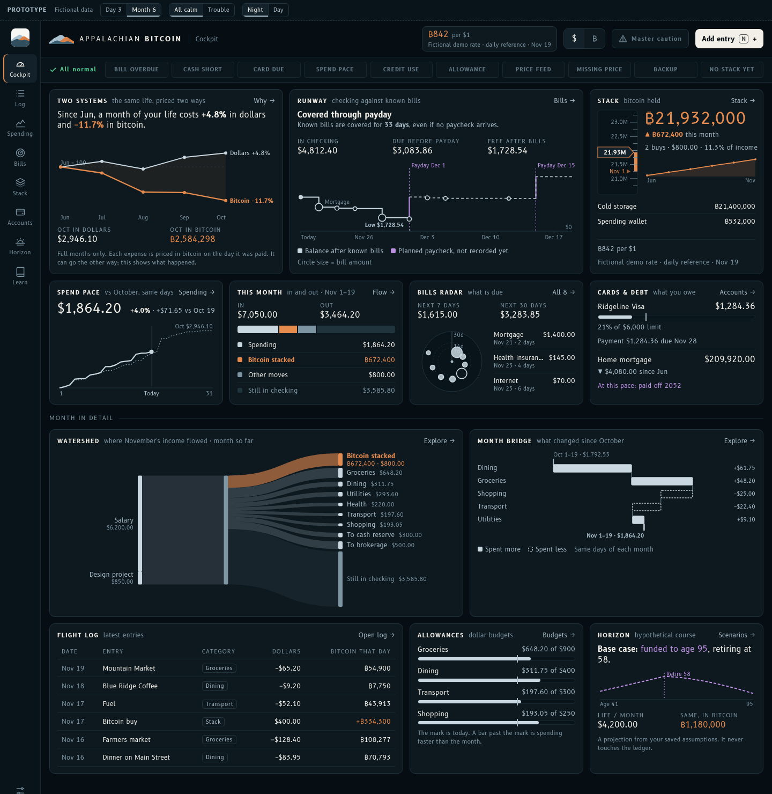
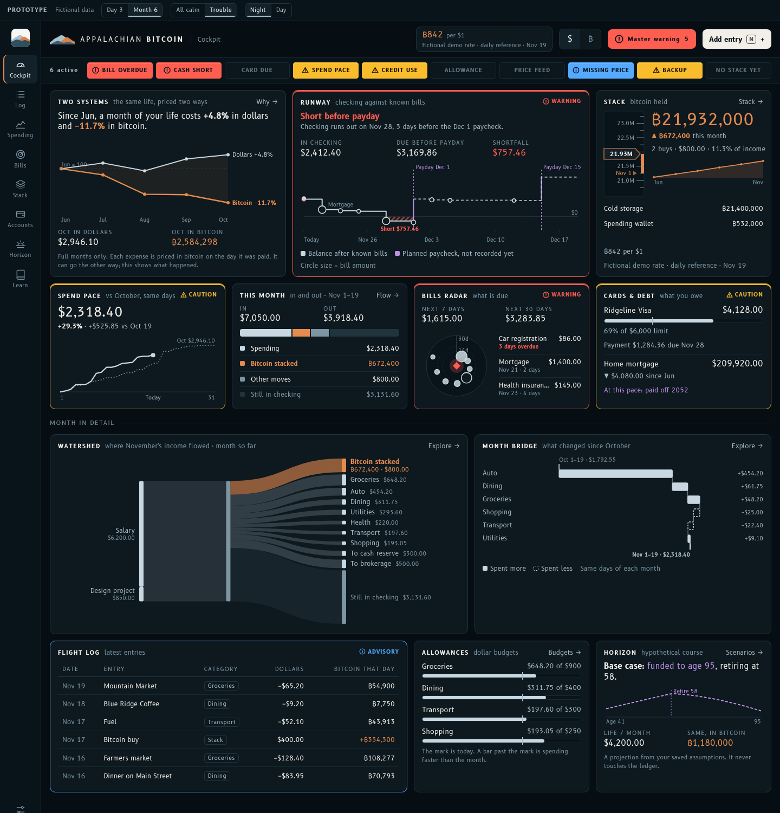
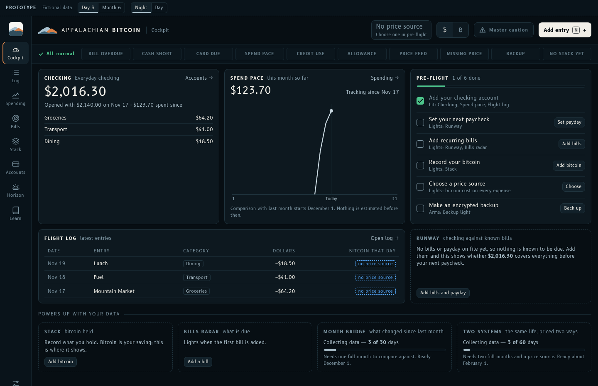
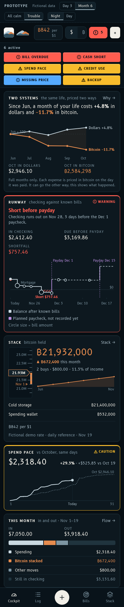

# Cockpit design brief

Status: **proposal, awaiting owner feedback.** Nothing in the running app has changed yet.
This document and the clickable prototype in [`docs/cockpit-prototype/`](cockpit-prototype/) are the whole of step 2.

## See it first

```sh
python3 -m http.server 5180 --bind 127.0.0.1 --directory docs/cockpit-prototype
```

Open <http://127.0.0.1:5180>. The dashed strip at the top is prototype-only: switch between **Day 3** (one account, three entries) and **Month 6**, between **All calm** and **Trouble**, and between **Night** and **Day**. Everything is fictional and static; no server or ledger is involved.

Things to try: press **Master warning** in Trouble; click a lit lamp; switch **$ / ₿** on the Spending screen; click a bridge row to drill down; press **N**.

| Month 6, all calm | Month 6, trouble |
| --- | --- |
|  |  |

| Day 3 | Phone, trouble |
| --- | --- |
|  |  |

More: [day theme](cockpit-prototype/screens/cockpit-day-theme.png), [Spending in bitcoin](cockpit-prototype/screens/spending-bitcoin.png), [design system and logo](cockpit-prototype/screens/design-system.png).

## What I found in the current app

I ran it against a new isolated database with the fictional demo seed. The owner's `data/` folder was never opened.

Worth keeping, and reused as is:

- The accounting core: integer cents and whole bitcoin units, Decimal half-even, append-only journal with SQLite triggers, reversals, immutable purchase-date cost records (`expense_costs`) with source and timestamp.
- Price sync and provenance (`prices.py`, `price_sync.py`, `conversions.py`), the forecasting engine, recurring bills with confirm-to-post, CSV import, encrypted backup and verified restore, auth and CSRF.
- `spendingAnalysis.ts`: exact BigInt pace and bridge maths. The three ideas the owner loves are sound; they are under-presented, not wrong.

Weak, and what the cockpit changes:

- **The top of Overview needs months of history.** "Your expenses, priced in bitcoin" leads the page and is blank or thin for a new user.
- **No sense of danger.** An overdue bill is a small link. Nothing says "checking will not cover the card payment".
- **Dollar leftovers are the headline.** "Safe to spend" and the Sankey's biggest ribbon, "Left in cash", celebrate dollars kept. Bitcoin stacked is a sliver.
- **A total net worth card is on Overview**, although `architecture.md` says none is shown.
- **Ten flat destinations and long pages of collapsible cards.** Related things live apart (Income, Transactions; Expenses, Budgets, Reports).
- **The wordmark** is Georgia set under a 6:1 landscape; widths and baselines do not agree.
- **The demo is too thin** to show a cockpit: no credit card, no paycheck schedule, one bitcoin buy a month.

## Information architecture

Nine destinations instead of eleven. Plain names lead; the one themed name ("Horizon") always carries its plain label.

| Destination | What lives there | Replaces |
| --- | --- | --- |
| **Cockpit** | The instrument panel and annunciator | Overview |
| **Log** (flight log) | Every entry, fast keyboard entry, corrections, import | Transactions, Income |
| **Spending** | Pace, Month bridge, Watershed, categories, allowances, history | Expenses, Budgets, most of Reports |
| **Bills** | Radar at full size, 30-day strip, recurring bills, paycheck schedule | Upcoming expenses |
| **Stack** | Bitcoin by wallet, every buy at the price paid, Two systems at full size, price source | Stacking, price settings |
| **Accounts** | Checking, cards, reserve, brokerage, property, loans | Accounts, Assets & liabilities |
| **Horizon** · retirement | Saved scenarios in both systems | Retirement |
| **Learn** (ground school) | The teaching space; contextual "Why" links land here | new |
| **Settings** | Warning-light thresholds, backup, security, categories, export | Settings |

Shell: a 76 px icon-and-label rail on desktop; a five-slot tab bar on phones (Cockpit, Log, **+**, Bills, Stack; the rest under More). Above the panel sits the glareshield: logo, price with provenance, the `$ / ₿` lens, Master caution, Add entry (`N`).

The lens changes how analysis is priced (pace, bridge, watershed, history). It never changes operational dollar readings: checking, bills and runway are always dollars.

## Instruments

Day-one instruments are on top. History-dependent ones sit lower and say what they are waiting for; none ever draws an empty chart. Once Two systems has two full months, it is promoted to the top-left slot.

| Instrument · plain label | Measures | Source | Day one | With history |
| --- | --- | --- | --- | --- |
| **Runway** · checking against known bills | Projected checking balance over 30 days: known bills step it down, planned paychecks step it up. Headline is "Covered through payday" or "Short before payday", with lowest point and days of bills covered with no paycheck | Account balance, `recurring_bills`, new `income_schedules` | Works once one bill exists. Before that it is dark and says what it needs | Same |
| **Stack** · bitcoin held | Bitcoin held on an altimeter tape, this month's climb, buys and dollars paid, share of income stacked, wallets, price and provenance | Balances, transfers into bitcoin accounts, `price_quotes` | Works with one holding | Monthly trend line appears from month two |
| **This month** · in and out | Dollars in; out split into spending, bitcoin stacked, other moves; and what is still in checking, shown dim and never praised | `flow`, `money_moved_out` | Works with one entry | Same |
| **Spend pace** · vs last month, same days | Cumulative spending against the same elapsed days last month | Expenses, `expense_costs` | Shows this month's line and says when comparison starts | Full comparison |
| **Bills radar** · what is due | Bills in the next 30 days. Closer to the centre is sooner; blips run clockwise in due order and are sized by amount; overdue sits in a red core. Always paired with a list | `recurring_bills`, `bill_occurrences` | Works with one bill | Same |
| **Cards & debt** · what you owe | Card balance against its limit with the caution threshold marked, next payment, loan balance and change | Liability accounts, new `card_terms` | Works with one card or loan | Payoff pace, labelled hypothetical |
| **Two systems** · the same life, priced two ways | Monthly cost of living indexed to the first full month, in dollars and in bitcoin at purchase-date prices | `expense_costs` | "Collecting data — 19 of 60 days" with a meter and ready date | Becomes the headline instrument |
| **Month bridge** · what changed since last month | A horizontal waterfall: which categories carry last month's total to this month's, same days of each | `analyzeSpending` | "Collecting data — n of 30 days" | Full |
| **Watershed** · where the month's income flowed | One picture of the month: income into bitcoin stacked (first, copper, the only bright stream), spending by category, other moves, and still in checking | `flow`, `stacked` | Works with income and one expense | Any month selectable |
| **Allowances** · dollar budgets | Category spending against its USD allowance, with a mark for how much of the month has passed | `budget_overview` | Works once one allowance is set | Same |
| **Horizon** · hypothetical course | The default saved scenario: funded-to age, retirement age, monthly life in both systems | `planning_scenarios`, forecasting engine | "No scenario yet" with one action | Same |
| **Flight log** · latest entries | The last entries with dollars and bitcoin that day | Journal, `expense_costs` | Works with one entry | Same |

The three ideas the owner loves:

- **Spend pace** keeps its name and moves up to the first screenful.
- **Spending bridge → Month bridge.** Redrawn horizontally so category names and amounts are readable and no axis is truncated. Filled bar means spent more, dashed outline means spent less.
- **Where the money went → Watershed.** My recommended name: income runs downhill into streams, and it belongs to these mountains. Its plain label, "where the month's income flowed", always sits beside it. Alternatives if it does not land: *Month flow*, *Flow map*. Bitcoin stacked is listed first and is the only saturated stream; "Still in checking" is dim and described as waiting, not saved.

All three work in dollars and bitcoin, drill down to the entries behind a number, label partial months ("Nov 1–19", "month so far"), and mark totals "partial" when a purchase-date price is missing.

## Warning lights

A fixed row of ten lamps. A dark lamp is normal; "All normal" is the calm state. Level is carried three ways at once: shape (circle, triangle, octagon), the word, and colour. Amber and red appear nowhere else in the product.

Each light states what is wrong, why it matters, and one action with a direct link. A flagged instrument takes the same colour on its top edge and a chip that opens the alert.

**Master caution** lights for any unacknowledged caution or warning. Pressing it acknowledges all of them, as in an aircraft: the master goes dark, each lamp stays lit but hollow until the condition clears. An acknowledged light returns to your attention when it gets worse: a higher level, or a magnitude past the acknowledged value (more days overdue, a deeper shortfall, a higher utilisation step).

| Lamp | Advisory (blue) | Caution (amber) | Warning (red) | One action |
| --- | --- | --- | --- | --- |
| Bill overdue | — | 1–2 days past due | 3+ days past due | Record payment |
| Cash short | — | Projected paying-account balance below $0 before the next paycheck, more than 7 days out | Same, within 7 days | Move money / reschedule |
| Card due | Payment due in ≤ 7 days | Due in ≤ 2 days | Past due | Make payment |
| Spend pace | — | Month to date ≥ 120% of last month's same days, and ≥ $150 more, from day 5 | never | See what changed |
| Credit use | — | Any card ≥ 30% of its limit | ≥ 90% | Plan a payment |
| Allowance | ≥ 90% used with more than 7 days left | Over 100% | never | Open category |
| Price feed | Quote older than 10 minutes | Automatic sync failing for 30+ minutes | never | Open price source |
| Missing price | Any expense without a purchase-date price | 10 or more, or one older than 14 days | never | Review missing prices |
| Backup | Last encrypted backup 14+ days ago | 30+ days ago, or never after 7 days of use | never | Back up now |
| No stack yet | By day 20: income recorded, no bitcoin bought this month | never | never | Record a bitcoin buy |

Against false alarms: every threshold above is a default, adjustable in Settings → Warning lights, and each lamp can be switched off. Manual-price mode never lights Price feed. Spend pace needs both a ratio and a dollar floor. Bills are confirm-to-post, so the first two days past due are a caution, not a warning.

Implementation: one pure function, `alerts(ledger_state, thresholds, today) -> list[Alert]`, in a new `backend/app/alerts.py`, with a test per trigger edge (just under, at, just over), per re-arm rule, and for "no alert on an empty ledger".

## Design system

Tokens live in [`cockpit-prototype/tokens.css`](cockpit-prototype/tokens.css) and will move unchanged into the app.

**Colour means one thing each.**

| Token | Night | Day | Meaning |
| --- | --- | --- | --- |
| `--btc` copper | `#E58B4E` | `#B1561D` | Bitcoin. Saving. |
| `--usd` mist | `#C9D8E0` | `#304E5D` | Dollars and neutral readings |
| `--plan` amethyst | `#BD90E4` | `#7A49B0` | Planned or hypothetical: paychecks not yet recorded, forecasts, payoff pace. Never a recorded fact |
| `--ok` green | `#4CC38A` | `#1A7C51` | In range |
| `--adv` / `--caution` / `--warn` | `#55AAFF` / `#F8BC2C` / `#FF5D50` | `#1461BD` / `#F3B11F` / `#C22F29` | Annunciator only |
| `--bg` / `--panel` / `--bezel` | `#070E13` / `#0D181F` / `#20343E` | `#EBE9E1` / `#FBFAF6` / `#CFCEC3` | Canvas, instrument face, instrument edge |

Amethyst for the hypothetical mirrors the magenta flight-plan line in a glass cockpit, and gives the rule "a forecast never creates a posting" a visible form. Income and expenses are not green and red; sign and position carry that, which frees red for real danger.

**Type.** B612, the open typeface Airbus commissioned for cockpit displays (OFL, self-hosted, no remote fonts). Its digits share one width, so every number aligns without a monospaced face. Scale: 10.5 / 11 / 12 / 13 / 15 / 18 / 24 / 30. Instrument names are 11 px tracked capitals with a sentence-case plain label beside them.

**Space, radius, elevation.** 4 px base (4, 8, 12, 16, 24, 32). Radii 4 (chips and lamps), 10 (instruments), 14 (sheets). Instruments are flat with a 1 px bezel; only overlays cast a shadow.

**Motion.** 120 ms for controls, 240 ms for panels, 700 ms for needles and lines settling on load. An unacknowledged warning lamp blinks; the master pulses; the radar sweeps. All stop under `prefers-reduced-motion`.

**States.** Every instrument has: not set up (dashed, says what it needs, one action), collecting (n of m with a ready date), partial (labelled), missing price (dashed "no price saved" tag, never a guess), loading (skeleton at final size), offline (last readings with their time, entry paused), locked (blanked). All are on the prototype's System screen.

**Charts** are hand-built SVG with `d3-scale` and `d3-shape` only; Recharts is retired. Every mark exposes its exact value on hover and keyboard focus, formatted from the integer amount. Floats are for coordinates only.

**Accessibility.** Lamps and instruments have text labels and `aria-label` summaries; the annunciator has a polite live region; focus is always visible. Checked in the prototype: no horizontal page scroll at 375 px. Targets for the build, not yet measured: WCAG AA contrast for all text in both themes, and 44 px touch targets on phones.

## Logo

The three-ridge mark stays: mist behind, copper in the middle, slate in front.

- Redrawn from three smooth paths on a 60 × 30 grid with a flat shared baseline, replacing the two hand-tuned files that disagreed with each other.
- **Horizontal** (header): mark, then the wordmark on one line in tracked B612 capitals, "APPALACHIAN" regular and "BITCOIN" bold, cap-height centred on the mark.
- **Stacked** (sign-in, splash): the wordmark is set to exactly the mark's width, so both edges align.
- **Icon / favicon / PWA**: the ridges full-bleed in an ivory rounded tile, legible at 16 px. Night theme lifts only the front ridge (`#3B6073`) so it does not sink into the canvas.
- An alternate serif wordmark, closer to today's, is on the System screen for comparison. I recommend the capitals: they read as an instrument maker's plate and align cleanly.

In the build the wordmark becomes outlined paths, and `mark.svg`, `mountains.svg`, `MountainMark.tsx`, `icon-192.png`, `icon-512.png` and the manifest are regenerated from one source.

## Earlier decisions

- **No combined net worth: keep, and enforce.** The current Overview shows one; the cockpit does not. Bitcoin and dollars stay in their own units.
- **Budgets are USD allowances: keep.** Renamed "Allowances" on the panel.
- **Compact, content-sized panels: keep.** A 12-column grid of instruments that size to content.
- **"Safe to spend": changed.** It becomes Runway's "Free after bills", measured to the next paycheck, not month end, and never presented as money kept.
- **Bitcoin price is quoted as bitcoin per dollar** (`₿842 per $1`), with the legacy `per BTC` figure one hover away. This is BIP-177 taken seriously, and worth the owner's explicit yes or no.

## Back end and migration

The schema stays; everything new is additive. Existing users upgrade in place through the migrations that already run at startup.

New tables (one migration each, no change to journal tables):

| Table | Purpose |
| --- | --- |
| `income_schedules` | Expected paychecks: account, amount, frequency (adds biweekly and semi-monthly), next date. Never posts by itself |
| `card_terms` | Credit limit and payment due day per card account |
| `alert_acknowledgements` | Lamp id, level and magnitude at acknowledgement, time |

Thresholds and the pre-flight checklist state go in the existing owner preferences JSON. New read endpoints: `GET /api/cockpit` (instrument readings) and `GET /api/alerts`. Existing endpoints stay until the new screens replace their callers.

Restore today refuses a backup from an older schema. I will extend it: authenticate, validate at the backup's own revision, migrate a temporary copy forward, validate again, then swap. Older backups then import directly.

Tests that prove no loss (isolated temporary databases only):

1. Seed a database at today's `main` head with the demo plus edge cases (reversals, a missing price, bitcoin-denominated expenses, a recorded bill, a scenario). Upgrade. Assert the JSON journal export, postings, exchange rates, cost records and conversion attachments are identical byte for byte, and every balance matches.
2. Make an encrypted backup at the old head, restore it into the new app, and assert the same.
3. Confirm the journal triggers still reject edits after migration.

The demo seed grows a credit card, a paycheck schedule, more bills and twice-monthly buys so every instrument has something to show.

## Front end

React, TypeScript, Vite and Tailwind 4 stay. The `src/` tree is rebuilt: `design/` (tokens, primitives), `instruments/` (one folder each: component, pure maths, tests), `annunciator/`, `screens/`. Money stays in BigInt and strings. Routing moves to real URLs so every drill-down is linkable.

## Build order after approval

Each step runs end to end and is checked in a browser at desktop and phone widths, both themes, on an empty ledger and the six-month demo.

1. Design system and logo.
2. Shell and navigation.
3. Cockpit with day-one instruments (Runway, Stack, This month, Spend pace, Bills radar, Cards & debt) and their migrations.
4. Annunciator, thresholds, acknowledgement, trigger tests.
5. History instruments (Two systems, Month bridge, Watershed).
6. Flight log and entry.
7. Bills, Stack, Accounts, Spending, Horizon, Settings.
8. Pre-flight checklist.
9. Learn.
10. Migration and restore tests, then removal of the old screens.

## Questions for the owner

1. **Watershed** as the new name for "Where the money went"?
2. **Wordmark**: tracked capitals (recommended) or the serif alternate?
3. **Price quoted as `₿842 per $1`** first, with `per BTC` secondary?
4. **"No stack yet"** as an advisory light by day 20: welcome, or too pushy?
5. **Bills radar**: keep the scope, or prefer a plain 30-day strip? The prototype shows the scope with its list.
6. Are the default thresholds about right for your own use, especially Spend pace (120% and $150) and Credit use (30%)?

## Not done yet

- Only Cockpit, Spending, Log and the System screen are prototyped. The other destinations are described above and show a placeholder.
- The prototype is static HTML; none of it is wired to the API, and no application code or migration has been written.
- The `₿` glyph falls back to a system font in the prototype; the build will ship a matched glyph.
- A few existing files still contain the retired unit name (for example `docs/monetary-lens-roadmap.md` and `Settings.tsx`); they will be cleaned up as each area is rebuilt.
