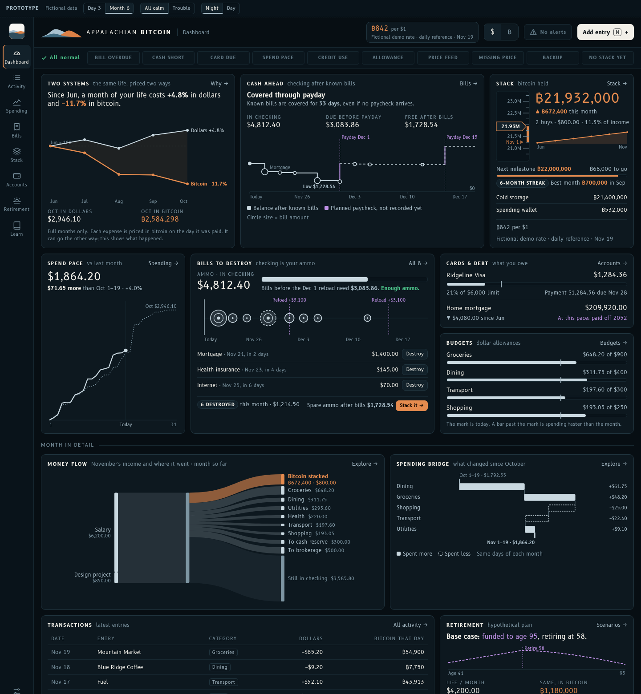
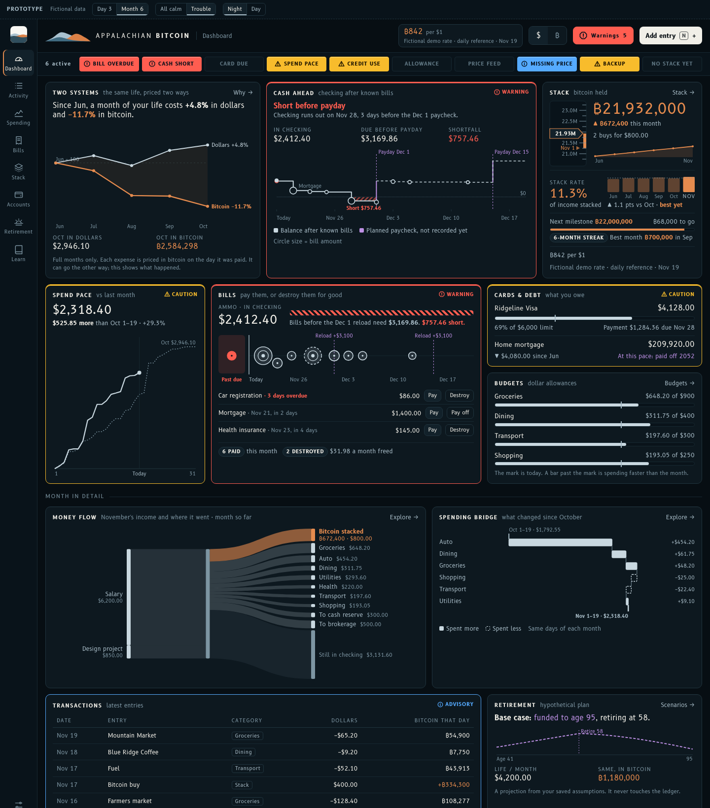

# Dashboard design brief

Status: **fourth draft, awaiting owner feedback.** "Cockpit" was shorthand for a dense dashboard, so this draft drops the flight vocabulary and uses plain names. The file keeps its original name.

Changed since the first draft: plain names throughout; the bills radar replaced by a bills panel with targets and ammo; "Watershed" renamed **Money flow**; a small game layer; clearer spend-pace wording.

Changed in the third draft: the logo redrawn as three gentle, layered hills (approved); a confirm step; spare ammo can be stacked.

Changed in this draft: bills are **paid** or **destroyed** (cancelled, or paid off in full); each alert light opens its own detail; **stack rate** is a headline number in Stack.

**Build status.** Steps 1–6 of the build order are in the app: design system and logo, shell and navigation, the dashboard's day-one panels on real data, the alert lights, the history panels (Cost of living, Spending bridge, Money flow) with the Spending screen, and the Transactions screen with keyboard entry, corrections and removal. Steps 7–10 are not built; those screens open in the previous interface at `/legacy.html`.
This document and the clickable prototype in [`docs/cockpit-prototype/`](cockpit-prototype/) are the whole of step 2.

## See it first

```sh
python3 -m http.server 5180 --bind 127.0.0.1 --directory docs/cockpit-prototype
```

Open <http://127.0.0.1:5180>. The dashed strip at the top is prototype-only: switch between **Day 3** (one account, three entries) and **Month 6**, between **All calm** and **Trouble**, and between **Night** and **Day**. Everything is fictional and static; no server or ledger is involved.

Things to try: in Trouble, **Pay** the overdue bill and watch its red light go out; **Destroy** a bill and see what it frees each year; try **Pay off** on the mortgage; click two different alert lights and compare what each shows; switch **$ / ₿** on the Spending screen; click a bridge row to drill down; press **N**.

| Month 6, all calm | Month 6, trouble |
| --- | --- |
|  |  |

| Day 3 | Phone, trouble |
| --- | --- |
|  |  |

More: [day theme](cockpit-prototype/screens/dashboard-day-theme.png), [Spending in bitcoin](cockpit-prototype/screens/spending-bitcoin.png), [design system and logo](cockpit-prototype/screens/design-system.png).

## What I found in the current app

I ran it against a new isolated database with the fictional demo seed. The owner's `data/` folder was never opened.

Worth keeping, and reused as is:

- The accounting core: integer cents and whole bitcoin units, Decimal half-even, append-only journal with SQLite triggers, reversals, immutable purchase-date cost records (`expense_costs`) with source and timestamp.
- Price sync and provenance (`prices.py`, `price_sync.py`, `conversions.py`), the forecasting engine, recurring bills with confirm-to-post, CSV import, encrypted backup and verified restore, auth and CSRF.
- `spendingAnalysis.ts`: exact BigInt pace and bridge maths. The three ideas the owner loves are sound; they are under-presented, not wrong.

Weak, and what the new dashboard changes:

- **The top of Overview needs months of history.** "Your expenses, priced in bitcoin" leads the page and is blank or thin for a new user.
- **No sense of danger.** An overdue bill is a small link. Nothing says "checking will not cover the card payment".
- **Dollar leftovers are the headline.** "Safe to spend" and the Sankey's biggest ribbon, "Left in cash", celebrate dollars kept. Bitcoin stacked is a sliver.
- **A total net worth card is on Overview**, although `architecture.md` says none is shown.
- **Ten flat destinations and long pages of collapsible cards.** Related things live apart (Income, Transactions; Expenses, Budgets, Reports).
- **The wordmark** is Georgia set under a 6:1 landscape; widths and baselines do not agree.
- **The demo is too thin** to show a full dashboard: no credit card, no paycheck schedule, one bitcoin buy a month.

## Information architecture

Nine destinations instead of eleven, all with plain names.

| Destination | What lives there | Replaces |
| --- | --- | --- |
| **Dashboard** | The panels and the row of alert lights | Overview |
| **Activity** | Every transaction, fast keyboard entry, corrections, import | Transactions, Income |
| **Spending** | Spend pace, Spending bridge, Money flow, categories, budgets, history | Expenses, Budgets, most of Reports |
| **Bills** | Every bill as a target at full size, 30-day view, recurring bills, paycheck schedule | Upcoming expenses |
| **Stack** | Bitcoin by wallet, every buy at the price paid, milestones, Cost of living at full size, price source | Stacking, price settings |
| **Accounts** | Checking, cards, reserve, brokerage, property, loans | Accounts, Assets & liabilities |
| **Retirement** | Saved scenarios in both systems | Retirement |
| **Learn** | The teaching space; contextual "Why" links land here | new |
| **Settings** | Alert thresholds, backup, security, categories, export | Settings |

Shell: a 76 px icon-and-label rail on desktop; a five-slot tab bar on phones (Dashboard, Activity, **+**, Bills, Stack; the rest under More). The top bar holds the logo, the price with its source, the `$ / ₿` switch, the alerts button, and Add entry (`N`).

The `$ / ₿` switch changes how analysis is priced (pace, bridge, money flow, history). It never changes operational dollar readings: checking and bills are always dollars.

## Panels

Panels that work on day one are on top. Panels that need history sit lower and say what they are waiting for; none ever draws an empty chart. Once Cost of living has two full months, it moves to the top-left slot.

| Panel | Measures | Source | Day one | With history |
| --- | --- | --- | --- | --- |
| **Cash ahead** | Projected checking balance over 30 days: known bills step it down, planned paychecks step it up. Headline is "Covered through payday" or "Short before payday", with the lowest point and how many days of bills are covered with no paycheck | Account balance, `recurring_bills`, new `income_schedules` | Works once one bill exists. Before that it says what it needs | Same |
| **Bills** | See below | `recurring_bills`, `bill_occurrences`, checking balance | Works with one bill | Same |
| **Stack** | Bitcoin held, this month's gain, buys and dollars paid, **stack rate**, next milestone, streak, best month, price and source | Balances, transfers into bitcoin accounts, `price_quotes` | Works with one holding | Monthly trend from month two |
| **Spend pace** | Exact spending so far this month, against the same days last month | Expenses, `expense_costs` | Shows this month's line and says when comparison starts | Full comparison |
| **Cards & debt** | Card balance against its limit, next payment, loan balance and change | Liability accounts, new `card_terms` | Works with one card or loan | Payoff pace, labelled hypothetical |
| **Budgets** | Category spending against its dollar allowance, with a mark for how much of the month has passed | `budget_overview` | Works once one allowance is set | Same |
| **Cost of living** | Monthly spending indexed to the first full month, in dollars and in bitcoin at purchase-date prices | `expense_costs` | "Collecting data — 19 of 60 days" with a meter and ready date | Becomes the headline panel |
| **Spending bridge** | Which categories carry last month's total to this month's, same days of each | `analyzeSpending` | "Collecting data — n of 30 days" | Full |
| **Money flow** | One picture of the month: income into bitcoin stacked (first, orange, the only bright stream), spending by category, other moves, and what is still in checking | `flow`, `stacked` | Works with income and one expense | Any month selectable |
| **Retirement** | The default saved scenario: funded-to age, retirement age, monthly life in both systems | `planning_scenarios`, forecasting engine | "No scenario yet" with one action | Same |
| **Transactions** | The latest entries with dollars and bitcoin that day | Journal, `expense_costs` | Works with one entry | Same |

### Bills: pay them, or destroy them for good

The owner's idea, and it is better than what I had: paying a bill does not destroy it, because it comes back next month. A bill is only destroyed when it is gone for good.

- Your checking balance is your **ammo**. A bar shows how much of it the bills before payday will use, and says "Enough ammo" or "$757.46 short".
- Each bill is a **target** on a 30-day line. Further left is sooner; a bigger target is a bigger bill. Overdue bills sit in a red "Past due" box left of Today. Each planned paycheck is a **reload**.
- **Pay** records this month's payment after a short confirm step (date, actual amount, account, ammo left). The target fades and ammo drops. It will be back next month.
- **Destroy** cancels a bill for good. The confirm step shows what that frees: "$22.99 a month, $275.88 a year you could stack instead". The target bursts. The app reminds you to cancel with the provider too, since it cannot do that for you.
- **Pay off** is how a debt is destroyed: it pays the whole balance of a card or loan from checking and removes the bill. If checking cannot cover it, the confirm step says how much more ammo is needed and will not proceed.
- The score: "6 paid this month" and "2 destroyed · $31.98 a month freed".
- When there is more ammo than the bills before payday need, the panel offers **Stack it**, which opens a bitcoin buy. The loop the app teaches: pay the bills, destroy the ones you can, stack what is spare.

In the ledger, Pay is the existing confirm-to-post bill payment, Destroy archives the recurring bill, and Pay off is a transfer for the full balance followed by archiving. No new accounting is needed.

### Game layer

The owner's framing: money is what you fight an uncertain future with. Dollars are ammo that loses power over time, bitcoin is the stronger weapon, stocks are a different one, and winning is simple: keep stacking.

What is in the design:

- **"Ammo" for dollars in checking, everywhere it appears.**
- **Stack rate is the score.** It is the share of this month's income that went into bitcoin, the bitcoin version of a savings rate, and higher is better. It sits in the Stack panel as a headline number with the last six months as bars, the change from last month, and a "best yet" mark when it is a record.
- **Supporting numbers**: next milestone of bitcoin held, the streak of months with a buy, and the best month so far. "Stack it" turns spare ammo into bitcoin, and the "No stack yet" light is the nudge.
- **Bills destroyed** and the dollars a month that freed.
- **Your own numbers make the purchasing-power point.** Cost of living shows a month of life costing more dollars and less bitcoin. It stays honest when the price moves the other way.

What I left out on purpose: relabelling every account as a weapon. That would be another metaphor to decode before a number can be read. The fuller framing of dollars, bitcoin and stocks belongs in Learn.

Easy to add later: a stack-rate target you set yourself, and an "All clear" badge for a month with every bill paid on time.

### Spend pace, in plain terms

The panel always shows exact tracked numbers: what you have spent so far this month, and how many dollars more or less that is than the same days last month. Nothing is rounded or estimated.

Separately, an amber alert light can come on when you are well ahead of last month. I have set that to both 20% and $150 ahead, starting on day 5, so a single early grocery run cannot trigger it. You can change or turn off that light in Settings; it does not affect the tracking.

### The three ideas the owner loves

- **Spend pace** keeps its name and moves to the first screenful.
- **Spending bridge** keeps its name. It is redrawn horizontally so category names and amounts are readable and no axis is cut short. A filled bar means spent more; a dashed outline means spent less.
- **Where the money went** becomes **Money flow**. Bitcoin stacked is listed first and is the only bright stream; "Still in checking" is dim and described as waiting, not saved.

All three work in dollars and bitcoin, drill down to the entries behind a number, label partial months ("Nov 1–19", "month so far"), and mark totals "partial" when a purchase-date price is missing.

## Alert lights

A fixed row of ten lights. A dark light is normal; "All normal" is the calm state. Level is carried three ways at once: shape (circle, triangle, octagon), the word, and colour. Amber and red appear nowhere else in the product.

Each light opens its own detail, not a shared list. The detail states what is wrong and why it matters, shows the figures behind it, and offers one action. For example, Credit use shows balance, limit, the bar against your 30% line and "Pay $2,328.00 to get back under your 30% line"; Spend pace shows this month against last and the three categories that grew most; Cash short lists the bills due before payday and the exact gap. Other active alerts are one click away at the bottom, and the alerts button in the top bar lists them all.

A flagged panel takes the same colour on its top edge and a chip that opens that alert.

The **alerts button** in the top bar lights for any unacknowledged caution or warning. Pressing it acknowledges all of them: the button goes dark, and each light stays on but hollow until the problem is fixed. An acknowledged light returns to your attention when it gets worse: a higher level, or a magnitude past the acknowledged value (more days overdue, a deeper shortfall, a higher utilisation step).

| Light | Advisory (blue) | Caution (amber) | Warning (red) | One action |
| --- | --- | --- | --- | --- |
| Bill overdue | — | 1–2 days past due | 3+ days past due | Pay it |
| Cash short | — | Projected paying-account balance below $0 before the next paycheck, more than 7 days out | Same, within 7 days | Move money / reschedule |
| Card due | Payment due in ≤ 7 days | Due in ≤ 2 days | Past due | Make payment |
| Spend pace | — | Month to date ≥ 120% of last month's same days, and ≥ $150 more, from day 5 | never | See what changed |
| Credit use | — | Any card ≥ 30% of its limit | ≥ 90% | Plan a payment |
| Allowance | ≥ 90% used with more than 7 days left | Over 100% | never | Open category |
| Price feed | Quote older than 10 minutes | Automatic sync failing for 30+ minutes | never | Open price source |
| Missing price | Any expense without a purchase-date price | 10 or more, or one older than 14 days | never | Review missing prices |
| Backup | Last encrypted backup 14+ days ago | 30+ days ago, or never after 7 days of use | never | Back up now |
| No stack yet | By day 20: income recorded, no bitcoin bought this month | never | never | Record a bitcoin buy |

Against false alarms: every threshold above is a default, adjustable in Settings → Alerts, and each light can be switched off. Manual-price mode never lights Price feed. Spend pace needs both a ratio and a dollar floor. Bills are confirm-to-post, so the first two days past due are a caution, not a warning.

Implementation: one pure function, `alerts(ledger_state, thresholds, today) -> list[Alert]`, in a new `backend/app/alerts.py`, with a test per trigger edge (just under, at, just over), per comes-back-when-worse rule, and for "no alert on an empty ledger".

## Design system

Tokens live in [`cockpit-prototype/tokens.css`](cockpit-prototype/tokens.css) and will move unchanged into the app.

**Colour means one thing each.**

| Token | Night | Day | Meaning |
| --- | --- | --- | --- |
| `--btc` copper | `#E58B4E` | `#B1561D` | Bitcoin. Saving. |
| `--usd` mist | `#C9D8E0` | `#304E5D` | Dollars and neutral readings |
| `--plan` amethyst | `#BD90E4` | `#7A49B0` | Planned or hypothetical: paychecks not yet recorded, forecasts, payoff pace. Never a recorded fact |
| `--ok` green | `#4CC38A` | `#1A7C51` | In range |
| `--adv` / `--caution` / `--warn` | `#55AAFF` / `#F8BC2C` / `#FF5D50` | `#1461BD` / `#F3B11F` / `#C22F29` | Alert lights only |
| `--bg` / `--panel` / `--bezel` | `#070E13` / `#0D181F` / `#20343E` | `#EBE9E1` / `#FBFAF6` / `#CFCEC3` | Canvas, panel face, panel edge |

Giving the hypothetical its own colour makes the rule "a forecast never creates a posting" visible. Income and expenses are not green and red; sign and position carry that, which frees red for real danger.

**Type.** B612, an open typeface designed for reading dense instrument displays at a glance (OFL, self-hosted, no remote fonts). Its digits share one width, so every number aligns without a monospaced face. Scale: 10.5 / 11 / 12 / 13 / 15 / 18 / 24 / 30. Panel names are 11 px tracked capitals with a sentence-case label beside them.

**Space, radius, elevation.** 4 px base (4, 8, 12, 16, 24, 32). Radii 4 (chips and lights), 10 (panels), 14 (sheets). Panels are flat with a 1 px edge; only overlays cast a shadow.

**Motion.** 120 ms for controls, 240 ms for panels, 700 ms for lines settling on load. An unacknowledged warning light blinks; the alerts button pulses; a paid bill fades and a destroyed bill bursts. All stop under `prefers-reduced-motion`.

**States.** Every panel has: not set up (dashed, says what it needs, one action), collecting (n of m with a ready date), partial (labelled), missing price (dashed "no price saved" tag, never a guess), loading (skeleton at final size), offline (last readings with their time, entry paused), locked (blanked). All are on the prototype's System screen.

**Charts** are hand-built SVG with `d3-scale` and `d3-shape` only; Recharts is retired. Every mark exposes its exact value on hover and keyboard focus, formatted from the integer amount. Floats are for coordinates only.

**Accessibility.** Lights and panels have text labels and `aria-label` summaries; alerts are announced through a polite live region; focus is always visible. Checked in the prototype: no horizontal page scroll at 375 px. Targets for the build, not yet measured: WCAG AA contrast for all text in both themes, and 44 px touch targets on phones.

## Logo

**Approved by the owner.** Two earlier drawings were wrong: first a flattened copy of the old artwork, then three steep peaks. The approved drawing is what the logo is: **three gentle rolling hills, layered like rows of Appalachian ridges, two blues and one orange for bitcoin.**

- Long and low, 4:1, as the original artwork was. Each ridge is one smooth curve with soft slopes and no points.
- Light blue is the furthest ridge, orange sits in the middle, dark blue is the nearest and trails off to the right.
- Flat colour only. No outlines or gaps between layers.
- **Horizontal** (header): the mark at full width beside the wordmark, in tracked capitals, "APPALACHIAN" regular and "BITCOIN" bold.
- **Stacked** (sign-in, splash): the wordmark is set to exactly the mark's width, so both edges align.
- **App icon and favicon**: the same three ridges running edge to edge across an ivory rounded tile, with the dark ridge filling the bottom; checked down to 16 px.
- On the dark theme only the dark-blue ridge is lifted a step (`#3F6A80`) so it does not sink into the background.
- A serif wordmark, closer to today's, is on the System screen for comparison.

In the build the wordmark becomes outlined paths, and `mark.svg`, `mountains.svg`, `MountainMark.tsx`, `icon-192.png`, `icon-512.png` and the manifest are regenerated from one source.

## Earlier decisions

- **No combined net worth: keep, and enforce.** The current Overview shows one; the new dashboard does not. Bitcoin and dollars stay in their own units.
- **Budgets are USD allowances: keep.**
- **Compact, content-sized panels: keep.** A 12-column grid of panels that size to content.
- **"Safe to spend": changed.** It becomes Cash ahead's "Free after bills", measured to the next paycheck, not month end, and never presented as money kept.
- **Bitcoin price is quoted as bitcoin per dollar** (`₿842 per $1`), with the legacy `per BTC` figure one hover away. Approved by the owner.

## Back end and migration

The schema stays; everything new is additive. Existing users upgrade in place through the migrations that already run at startup.

New tables (one migration each, no change to journal tables):

| Table | Purpose |
| --- | --- |
| `income_schedules` | Expected paychecks: account, amount, frequency (adds biweekly and semi-monthly), next date. Never posts by itself |
| `card_terms` | Credit limit and payment due day per card account |
| `alert_acknowledgements`, `alert_settings` | What was acknowledged (light, level, magnitude, time) and the saved thresholds |

Thresholds have their own table because the owner preferences are a strict schema; the setup checklist is derived from the ledger. All of this is one additive migration, `0014_dashboard`. New read endpoints: `GET /api/dashboard` (panel readings) and `GET /api/alerts`. Existing endpoints stay until the new screens replace their callers.

Restore today refuses a backup from an older schema. I will extend it: authenticate, validate at the backup's own revision, migrate a temporary copy forward, validate again, then swap. Older backups then import directly.

Tests that prove no loss (isolated temporary databases only):

1. Seed a database at today's `main` head with the demo plus edge cases (reversals, a missing price, bitcoin-denominated expenses, a recorded bill, a scenario). Upgrade. Assert the JSON journal export, postings, exchange rates, cost records and conversion attachments are identical byte for byte, and every balance matches.
2. Make an encrypted backup at the old head, restore it into the new app, and assert the same.
3. Confirm the journal triggers still reject edits after migration.

The demo seed grows a credit card, a paycheck schedule, more bills and twice-monthly buys so every panel has something to show.

## Front end

React, TypeScript, Vite and Tailwind 4 stay. The `src/` tree is rebuilt: `design/` (tokens, primitives), `panels/` (one folder each: component, pure maths, tests), `alerts/`, `screens/`. Money stays in BigInt and strings. Routing moves to real URLs so every drill-down is linkable.

## Build order after approval

Each step runs end to end and is checked in a browser at desktop and phone widths, both themes, on an empty ledger and the six-month demo.

1. Design system and logo.
2. Shell and navigation.
3. Dashboard with day-one panels (Cash ahead, Bills, Stack, Spend pace, Cards & debt, Budgets) and their migrations.
4. Alert lights, thresholds, acknowledgement, trigger tests.
5. History panels (Cost of living, Spending bridge, Money flow).
6. Activity and entry.
7. Bills, Stack, Accounts, Spending, Retirement, Settings.
8. Setup checklist.
9. Learn.
10. Migration and restore tests, then removal of the old screens.

## Decisions so far

- Logo, three gentle layered hills: **approved.**
- Price quoted as `₿842 per $1`: **approved.**
- "No stack yet" light: **approved.**
- **Money flow** as the name: **approved.**
- Confirm step before a payment is recorded: **approved.**
- Pay versus Destroy, and Pay off for debts: **the owner's idea, adopted.**
- Stack rate as a headline: **requested, added.**
- Each alert light has its own detail: **requested, added.**
- "Watershed", the bills radar, flight vocabulary: **rejected and removed.**

## Questions for the owner

1. **Wordmark**: tracked capitals or the serif alternate?

## Not done yet

- Only Dashboard, Spending, Activity and the System screen are prototyped. The other destinations are described above and show a placeholder.
- The prototype is static HTML; none of it is wired to the API, and no application code or migration has been written.
- The `₿` glyph falls back to a system font in the prototype; the build will ship a matched glyph.
- A few existing files still contain the retired unit name (for example `docs/monetary-lens-roadmap.md` and `Settings.tsx`); they will be cleaned up as each area is rebuilt.
